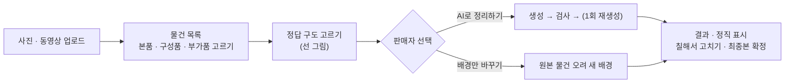

# Carret 🥕

*[English](Readme.md)*

**대충 찍은 중고 사진을 정직한 상품 사진으로.**

중고 거래에선 예쁜 사진보다 **믿을 수 있는 사진**이 먼저입니다. 생성형 편집 모델은 배경만 바꿔 달라고 해도
흠집을 "고치고", 로고를 바꾸고, 없던 부품을 그려 넣습니다 — 중고 거래에선 그게 곧 허위 매물입니다.
Carret 은 생성 AI 를 쓰되 **정직함을 프롬프트에 부탁하지 않고 구조로 막는** 상품 사진 도구입니다.

> 원칙: **배경은 바꾸고, 물건의 정체는 지키고, 상태는 원본으로 보여준다.**

---

## 📌 한눈에 보기

| | |
|---|---|
| **문제** | 생성 모델은 물건을 조용히 바꾼다 (로고 글자 · 핸들 모양 · 개수 · 없던 화면) |
| **해결** | 정직함을 4층으로 — ① 생성 전 위험 판단 ② 입력 통제 ③ 생성 뒤 검사 · 재생성 ④ 사람 확인 · 정직한 표시 |
| **선택지** | 판매자가 **[AI로 정리하기]**(생성)와 **[배경만 바꾸기]**(원본 물건 픽셀 그대로)를 직접 고른다 |
| **스택** | FastAPI · LangGraph · fal.ai (FLUX.2 edit) · Gemini (VLM) · DINOv2 · OpenCV · SQLite/S3 · Langfuse · Vanilla JS |
| **품질** | 유닛 테스트 798개 (외부 호출 없음, PR마다 CI) + 실제 API 를 부르는 eval 스위트 |

---

## 🛡️ 정직함을 어떻게 지키나 (프롬프트 말고)

| 층 | 하는 일 | 근거가 된 실패 |
|---|---|---|
| ① 생성 전 | 사진을 분석해 위험 이유(잘림 · 겹침 · 하자 많음 · 여러 개)를 판매자에게 보여 주고 고르게 한다. 정답 구도로 만들 사진이 모자라면 모델이 **필요한 사진을 요청**한다 | CD 2장 → 1장 · 3장, 세트 4번 생성 4번 실패 |
| ② 입력 통제 | 정답 구도는 **원본 사진 대신 선 그림 + 동작 문장**으로 준다. 대표사진은 판매자가 고른 물건만 | 정답 사진을 넣자 정답 속 다른 물건을 베낌 (맥북 → 에어) |
| ③ 생성 뒤 | 원본의 로고 · 마크가 그대로인지 체크리스트 검사, 세트는 종류별 개수 검사. 떨어지면 이유를 붙여 1회 재생성 | 검사 없이 내보낸 결과에 로고 변형 · 케이스 복제 |
| ④ 사람 | 결과마다 "AI 가 다시 그림 / 원본 물건 그대로"를 구분해 표시. 틀린 곳은 **칠해서 고치기**, 최종본은 판매자가 확정 | 자동 검사가 핸들 모양 · 없던 화면을 못 잡음 |

**아직 못 한 것 — 그래서 지금 하는 것.** 검사를 통과한 생성본이 정말 원본과 같은지는 사람이 재야 합니다.
사람 라벨(추가 · 누락 · 변형)로 "통과한 사진 중 다른 사진 ≤ ε" 의 신뢰 상한을 재는 중입니다
— 물건 유사도 점수는 사람 판정과 상관이 0.4 수준이라(Amazon 연구) 보증이 되지 못합니다 ([공부 정리](study/honesty-metric/README.md)).

---

## 🧭 사용 흐름



1. **업로드** — 사진 여러 장 · 동영상(장면을 골라 냄). 같은 물건끼리 묶고 사진마다 무엇이 보이는지 검토
2. **물건 고르기** — 고른 것 전부를 생성한다. 고르지 않으면 본체 하나, 나머지 구성품은 결과 아래 검증 목록으로
3. **정답 구도** — 원하는 구도의 정답(선 그림 + 동작 문장)을 고른다. 그 구도에 필요한 사진이 없으면 요청
4. **두 기능은 별개** — 생성은 검사에서 떨어져도 배경 교체로 몰래 바뀌지 않고, 기록과 함께 그대로 보여 준다
5. **글자** — 잔글씨 · 라벨은 생성이 정확히 못 지킨다. 대표사진에선 판단하지 않고 **근접 사진(검증용)을 따로** 받는다

---

## 🏗️ 파이프라인

LangGraph `StateGraph` — [`backend/app/services/pipeline/`](backend/app/services/pipeline/__init__.py) (역할별 9개 파일)

```
load → analyze → plan ─┬─ 생성:      [read_text] → generate → validate_result → score_similarity → verify ─┐
                       ├─ 배경 교체: composite (원본 물건 픽셀 + 새 배경)                                  ├→ save_inspect → finalize
                       └─ 원본 그대로: keep_original                                                    ┘
```

| 파일 | 하는 일 |
|---|---|
| `analysis.py` | 원본 분석(VLM 1회): 물건 · 로고 마크 · 사진 종류 · 하자 · 글자 수준 · 위치 |
| `selection.py` | 판매자 선택 반영 · 세트 구성품 세기 |
| `routing.py` | 갈림길 — 판매자 선택(`user_mode`)과 위험 이유(`risk_reason`) |
| `generation.py` | 정답 구도(선 그림 · 문장) · 최소 프롬프트 · 세트 JSON · generate |
| `checks.py` | 사진 성립 · 마크 보존 · 개수 검사 · 재생성 표시 · 관측 신호(DINO) |
| `composite.py` | 배경 교체 · 원본 그대로 |
| `results.py` · `graph.py` | 기록(inspect · DB) · 그래프 조립 · `run_transform` |

**물건 1개 기준** 생성 경로 약 **$0.03**, 35~60초 (Gemini flash 분석 · 검사 + fal FLUX.2 flash, 2026-09-29 Langfuse 중앙값).

---

## 🚀 시작하기

```bash
python -m venv venv1 && source venv1/bin/activate
pip install -r requirements.txt
cd backend && touch .env      # FAL_KEY, VLM_KEY(Gemini) 필수 / LANGFUSE_* 선택
uvicorn main:app --reload     # http://localhost:8000
pytest test/software/unit -q  # 무료 유닛 테스트 (CI 와 같음)
```

`PIPELINE_MODE=mock` 이면 외부 호출 없이 돈다. 설정 전체는 [`app/core/config.py`](backend/app/core/config.py).

---

## 📚 더 보기

| | |
|---|---|
| [`docs/how-it-works.ko.md`](docs/how-it-works.ko.md) | **지금 동작 한 장 정리** — 화면 흐름 · 파이프라인 단계 · 검사 · DB · eval 도구 (README 보다 자세히) |
| [`study/`](study/) | 날짜별 개발 노트 — 무엇을 왜 정했고 무엇을 뒤집었나 (README 의 근거) |
| [`study/honesty-metric/`](study/honesty-metric/README.md) | "보증할 수 있는" 정직함 지표 — 논문 · 통계 정리와 설계안 |
| [`docs/lessons.ko.md`](docs/lessons.ko.md) | 설계 결정 · 실패와 교훈 (버그 30여 건과 거기서 배운 것) |
| [`CHANGELOG.md`](CHANGELOG.md) | 날짜별 변경 기록 |
| [`backend/eval/`](backend/eval/README.md) | 평가 스위트 · 결과 보기(`view_runs.py`) · 정직함 라벨(`label_honesty.py`) |
| [`docs/archive/`](docs/archive/) | 줄이기 전의 README 전문 (2026-10-10) |
