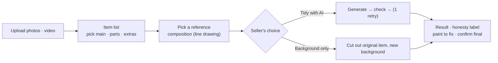

# Carret 🥕

*[한국어](Readme.ko.md)*

**Turn casual second-hand photos into honest product photos.**

In second-hand trading a **trustworthy photo** matters more than a pretty one. Generative editors asked to "just change
the background" still fix scratches, alter logos and draw parts that were never there — on a resale listing that is a
false listing. Carret uses generative AI but **enforces honesty with structure, not by asking the prompt nicely**.

> Principle: **change the background, keep the item's identity, show its real condition.**

---

## 📌 At a Glance

| | |
|---|---|
| **Problem** | Generative models silently change the item (logo lettering, handlebar shape, counts, a screen that wasn't there) |
| **Approach** | Four layers of honesty — ① risk check before generating ② controlled inputs ③ checks + one retry after generating ④ human confirmation and honest labels |
| **Choice** | The seller picks **[Tidy with AI]** (generation) or **[Background only]** (original item pixels kept) |
| **Stack** | FastAPI · LangGraph · fal.ai (FLUX.2 edit) · Gemini (VLM) · DINOv2 · OpenCV · SQLite/S3 · Langfuse · Vanilla JS |
| **Quality** | 798 unit tests (no external calls, CI on every PR) + an eval suite that calls the real APIs |

---

## 🛡️ How Honesty Is Enforced (not by prompting)

| Layer | What it does | Failure that motivated it |
|---|---|---|
| ① Before | Analyse the photo and show risk reasons (cut off, overlapping, heavy wear, many items) so the seller chooses. If the photos cannot support the chosen composition, a VLM **asks for the missing photo** | 2 CDs became 1 or 3; a set failed 4 of 4 generations |
| ② Inputs | Reference compositions are given as **line drawings + action sentences**, never the reference photo. Only items the seller picked are generated | Feeding the reference photo copied the reference product (MacBook → Air) |
| ③ After | Checklist that the original logos/marks survived, per-kind piece counts for sets. On failure, one retry with the reason attached | Shipped results had altered logos and duplicated game cases |
| ④ Human | Each result says "redrawn by AI" vs "original item". Wrong spots can be **painted and fixed** (A/B of two inpainting models); the seller confirms the final photo | Automatic checks missed a changed handlebar and an invented screen |

**Not solved yet — and what we are doing about it.** Whether a generated photo that *passed* the checks really matches the
original has to be measured by people. We are labelling results (added / missing / changed) to bound "share of passed
photos that differ ≤ ε" with a confidence interval — item-similarity scores correlate only ~0.4 with human judgement
(Amazon study), so they cannot serve as a guarantee ([notes, Korean](study/honesty-metric/README.md)).

---

## 🧭 User Flow



Text and small labels are not judged on the hero photo — generation cannot keep fine print exactly, so the seller is
asked for **close-up photos as verification** instead.

---

## 🏗️ Pipeline

LangGraph `StateGraph` — [`backend/app/services/pipeline/`](backend/app/services/pipeline/__init__.py) (9 files by role)

```
load → analyze → plan ─┬─ generate:   [read_text] → generate → validate_result → score_similarity → verify ─┐
                       ├─ background: composite (original item pixels + new background)                    ├→ save_inspect → finalize
                       └─ original:   keep_original                                                        ┘
```

| File | Role |
|---|---|
| `analysis.py` | One VLM call: item, identity marks, photo type, wear, text level, location |
| `selection.py` | Seller's picks · counting set pieces |
| `routing.py` | Branching — seller's choice (`user_mode`) and risk reasons (`risk_reason`) |
| `generation.py` | Reference composition, minimal prompt, set JSON, `generate` |
| `checks.py` | Photo validity, mark preservation, piece counts, retry note, DINO signals |
| `composite.py` | Background replacement, keep original |
| `results.py` · `graph.py` | Inspect/DB records, graph assembly, `run_transform` |

About **$0.03** and 35–60 s per item on the generation path (Gemini flash + fal FLUX.2 flash; Langfuse medians, 2026-09-29).

---

## 🚀 Getting Started

```bash
python -m venv venv1 && source venv1/bin/activate
pip install -r requirements.txt
cd backend && touch .env      # FAL_KEY, VLM_KEY (Gemini) required / LANGFUSE_* optional
uvicorn main:app --reload     # http://localhost:8000
pytest test/software/unit -q  # free unit tests (same as CI)
```

`PIPELINE_MODE=mock` runs without external calls. All settings: [`app/core/config.py`](backend/app/core/config.py).

---

## 📚 More

| | |
|---|---|
| [`docs/how-it-works.ko.md`](docs/how-it-works.ko.md) | **How it works now**, in detail — screens, pipeline steps, checks, DB, eval tools (Korean) |
| [`study/`](study/) | Dated dev notes (Korean) — why each decision was made and which were reversed |
| [`docs/lessons.ko.md`](docs/lessons.ko.md) | Design decisions, failures and lessons (Korean) |
| [`CHANGELOG.md`](CHANGELOG.md) | Change log (Korean) |
| [`backend/eval/`](backend/eval/README.md) | Eval suite, result viewer, honesty labelling page |
| [`docs/archive/`](docs/archive/) | The full previous README (2026-10-10) |
